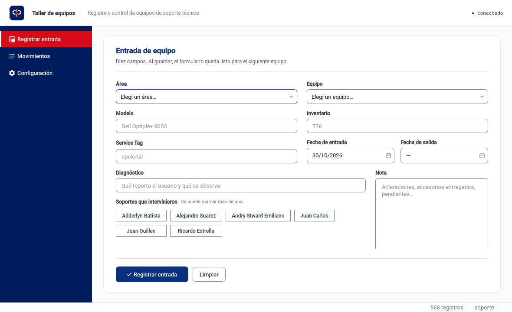

<div align="center">
  
</div>

<div align="center">

[](https://www.python.org/)
[](https://www.qt.io/)
[](https://www.postgresql.org/)
[](#testing)
[](LICENSE)

**A desktop application that records the intake and dispatch of IT equipment in a
workshop, replacing a legacy `.NET WinForms` export with a normalized database and a
client several technicians share over the local network.**

</div>

---

## The problem

The workshop kept its history in a text file exported from a `DataGridView`. The
first column held `System.Drawing.Bitmap` — the icon cell, not a status. Department
names were typed 191 different ways, technicians appeared under 38 spellings, dates
were occasionally reversed, and inventory codes mixed the letter `O` with the digit
`0`.

This project imports those 568 rows **without guessing**, then prevents the same
mess from coming back: the app offers catalogs instead of free text, derives the
status instead of storing it, and lets the database reject what the interface should
never have produced.

<div align="center">
  
</div>

## Features

**Data integrity**
- Status (dispatched / in the workshop / no data) is **derived** from the departure
  date, never stored, so it cannot desynchronise.
- Business dates are `DATE`: every timestamp in the legacy file was midnight, so a
  `TIMESTAMPTZ` would promise precision the data does not have.
- A `CHECK` rejects a departure earlier than the intake. The only escape hatch is a
  flag that imported rows alone may carry.
- Inventory codes normalise to their canonical five digits and keep leading zeros.

**Daily use**
- Fast keyboard entry: `Ctrl+Enter` saves and leaves the form ready for the next unit.
- Double click opens the full record instead of editing one cell at a time.
- Search ignores accents and case, and requires every word: `dvd agromet` finds the
  DVD drive from the Agrometeorology department.
- One click dispatches a unit; the button only enables "mark as reviewed" when the
  dates are consistent.
- CSV export of exactly what the filters are showing, formatted for Excel in a
  Spanish locale (semicolon, UTF-8 BOM, `dd/mm/aaaa`).

**Administration**
- Catalogs for equipment types, departments and technicians: create, rename,
  deactivate, reactivate and **merge duplicates**, showing how many records move
  before anything changes.
- An admin mode that deletes a whole record, requiring the equipment code typed as
  confirmation, and keeping a snapshot of what was deleted.
- Field-level audit trail: who changed what, with the previous and new value.

## Quick start

Requires PostgreSQL 18 and [uv](https://docs.astral.sh/uv/).

```bash
uv sync
cp .env.example .env          # point TALLER_DATABASE_URL at your database
uv run alembic upgrade head
./.venv/bin/python -m taller.main
```

The interface is in Spanish, which is the language of its users. The code,
comments and documentation are in English.

## Architecture

```text
src/taller/
  main.py            entry point: user, connection guard, window
  servicios.py       the only seam between widgets and the database
  database/          models, repositories, connection
  schemas/           Pydantic: the validation boundary
  inventario.py      inventory-code rules, one definition for three callers
  etl/               one-shot import of the legacy export
  ui/                theme, icons, models, delegates, views
```

Three rules hold the layering together: repositories **never commit** (the caller
owns the transaction), they return **DTOs and never ORM instances** (a detached
object crossing a Qt thread is a bug waiting to happen), and there is **one session
per operation**.

Read [`docs/arquitectura.md`](docs/arquitectura.md) for the schema, the import
rules and the colour decisions.

## Testing

```bash
./.venv/bin/python -m pytest
```

> Use `./.venv/bin/python -m pytest` rather than `pytest`: a wrapper on `PATH` in
> some environments swallows the report and prints "No tests collected" while the
> tests actually ran.

248 tests. The suites split by what they need: pure rules with no database, the Qt
model with a persistence double and `QT_QPA_PLATFORM=offscreen`, and the repositories
against a real PostgreSQL inside a transaction that is rolled back.

## Packaging

```bash
scripts/empaquetar.sh
```

Builds `dist/taller-equipos/` with PyInstaller — a directory, not a single file, so
the window appears instantly instead of unpacking Qt into a temporary folder on every
start. The binary needs no Python installed and answers `--version` for support.

## License

MIT — see [LICENSE](LICENSE).
